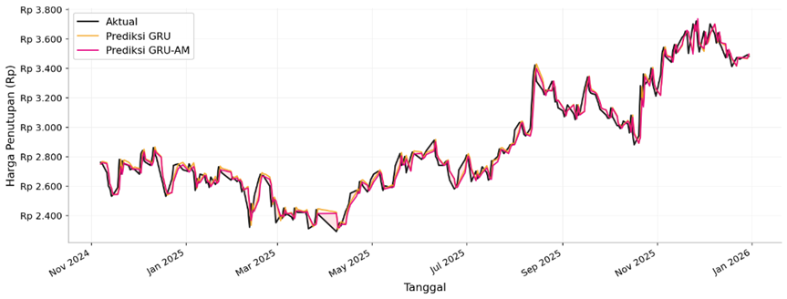

# Stock Price Forecasting of PT Telkom Indonesia (TLKM)

Comparison of two deep learning models, GRU and GRU with Attention Mechanism
(GRU-AM), to forecast the daily closing price of TLKM.

## Overview
- Data: 2,710 daily records from Yahoo Finance (Jan 2015 – Dec 2025)
- Tuning: grid search over 81 hyperparameter combinations per model
- Evaluation: 271 trading days using RMSE, MAE, MAPE, and R-squared

## Results
Both models performed comparably. GRU-AM reached MAE Rp51.59 and MAPE 1.78%,
while GRU reached RMSE Rp68.97 and R-squared 0.965. Diebold-Mariano, Wilcoxon,
and block bootstrap tests showed no statistically significant difference.

### Actual vs Predicted Closing Price
The predictions of both models closely follow the actual TLKM closing price on
the 271-day test set.

## Author
Ikhsan Ari Novianto · [LinkedIn](https://linkedin.com/in/ikhsanarinovianto)

*For academic purposes only, not financial advice.*
